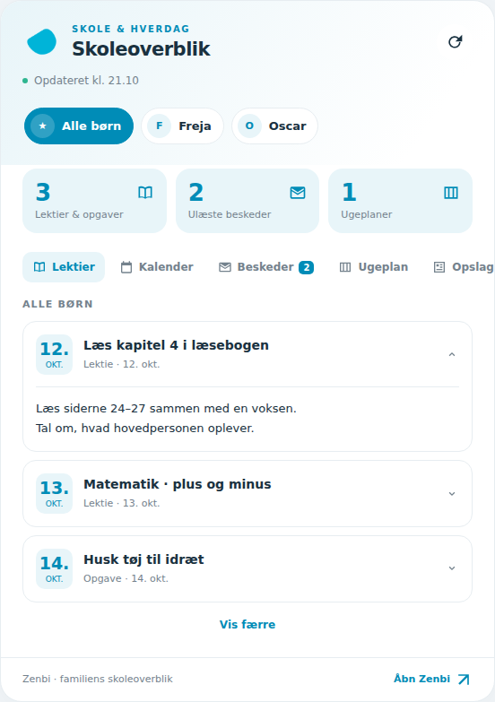

# Zenbi til Home Assistant


[](https://github.com/Timhonore/ha-zenbi/actions/workflows/validate.yml)

**Udgivelse v.1.2.7 — uofficiel integration.**
HA, diagnostik og card bruger det interne versionsnummer `1.2.7`.

Henter lektier, opgaver, ugeplaner, kalender, beskeder og opslag fra den konto,
du selv har adgang til på `app.zenbi.dk`. Installeres gennem HACS som et custom
repository: **https://github.com/Timhonore/ha-zenbi**.

## Installer gennem HACS

1. Åbn **HACS → menuen med tre prikker → Custom repositories**.
2. Indsæt `https://github.com/Timhonore/ha-zenbi`, og vælg **Integration**.
3. Find **Zenbi**, download integrationen og genstart Home Assistant.
4. Tilføj **Zenbi** under **Indstillinger → Enheder og tjenester**.
5. Log ind og vælg børnene.

Zenbis officielle appikon er inkluderet. Lokale brandikoner vises i Home
Assistant fra version 2026.3; tidligere versioner kan vise standardikon.

## Nyt i 1.2.7

- Fagpåmindelses-blueprinten kan overvåge flere børnekalendere og sende til
  flere telefoner i én automation. Ét matchende barn giver én påmindelse til
  hver telefon, uanset antal timer. Barnets navn hentes fra kalenderen.
- De tidligere enkeltvalg virker stadig efter genimport. Nye flervalg har
  forrang, så en tidligere telefon ikke utilsigtet fortsætter som modtager.
- Opdater integrationen og genimporter blueprinten. HACS opdaterer ikke den
  allerede importerede blueprint i din HA automatisk.

## Nyt i 1.2.6

- Retter en fejl i cookie-håndteringen i 1.2.5: `__Host-zenbi-session` er
  en sessionsmarkør. De beskyttede `token`- og `refreshToken`-cookies på
  `/api/` gemmes og sendes nu også, så API-kald efter login kan godkendes.
- Cookies kontrolleres for korrekt host, sti og HTTPS og holdes adskilt pr. konto.
- HA skelner nu mellem afvist login og afvist session ved datahentning.
- Opdater i HACS, genstart HA og genautentificer den eksisterende integration.

## Nyt i 1.2.5

- Login og automatisk fornyelse understøtter Zenbis nye cookie-session.
  Den aktuelle webapp returnerer `token` og `maxAge` uden `refreshToken`.
- Sessionen gemmes i HA og holdes adskilt mellem konti. Fornyelse bruger
  sessionscookien med tom request-body, som Zenbis aktuelle webapp.
- **Opdater i HACS, genstart HA og genautentificer Zenbi én gang.** Gamle
  bearer-/refresh-tokens kan ikke erstatte den nye sessionscookie. Behold
  integrationen, så entiteter og automationer bevares.
- Sessionens varighed følger Zenbis `maxAge`. Adgangskoden gemmes ikke.

## Nyt i 1.2.4

- Vælg **Standardbarn** i korteditoren. Kortet åbner med det valgte barn,
  fx i en popup. Hvert kort har sit eget valg, og du kan stadig skifte barn.
- YAML: `default_child: <barnets-id>`; uden feltet vises **Alle børn**.
  Manuelle `children` bruger deres `id` (eller `custom-0`, `custom-1`, osv.).
- Et utilgængeligt barn falder tilbage til **Alle børn**. Beskeder og opslag
  er fortsat fælles for kontoen. Opdateringer nulstiller ikke et manuelt valg.

## Nyt i 1.2.3

- **Opslag** hentes fra Zenbis opslagstavle, som vises på forsiden,
  frem for dagbogens relationsindlæg. Aktive opslag vises med titel og tekst.
- Samme datakilde og datofilter som Zenbis forside; højst 100 hentes,
  og sensorens eksisterende grænse på 50 viste elementer bevares.
- Opdater i HACS og genstart HA. Kortets resource-URL er uændret.

## Nyt i 1.2.2

- Automatisk tokenfornyelse matcher nu Zenbis app: godkendt refresh-request
  og fornyelse mindst en time før udløb, med ekstra margen ved langsom polling.
- Valg af børn deler tokenfornyelse med den kørende integration.
- Opdater i HACS og genstart HA. Hvis Zenbi allerede har afvist din session,
  skal du logge ind én gang igen.

## Nyt i 1.2.1

- Støttepunkter i præcis samme tidsrum som et fag for samme barn samles i én
  række, fx **0A naturfag m. Støtte**. Ekstra støttetekst bevares i den udfoldede tekst.
- I visningen med alle børn tilføjes støtte kun for de børn, den gælder for.
  Støtte uden et matchende fag/tidsrum vises fortsat som et selvstændigt punkt.
- Sammenlægningen gælder kun cardets skoleskema; kalenderens data ændres ikke.

## Nyt i 1.2.0

- **Skoleskema** er et separat emne i korteditoren (`timetable` i YAML).
- Viser børnenes kalenderpunkter fra Zenbis ugeplansvisning, opdelt efter dag,
  med start/sluttid, fag eller aktivitet og eventuel uddybende tekst.
- Børnevalg og ugevælger virker også i skoleskemaet. Tomme skoledage vises,
  og weekenddage med aktiviteter kommer med.
- Adgang til de tilhørende børnekalendere kontrolleres, og private begivenheder
  følger samme maskering som integrationens eksisterende kalender.

## Nyt i 1.1.0

- Ugevælger nederst på ugeplansfanen med ugenumre, forrige/næste uge og **Denne uge**.
- Valgte uger hentes direkte via integrationen, også uden for sensorernes periode.
- Børnevalg filtrerer den valgte uges planer. ISO-uger håndteres ved årsskiftet.
- Kortet viser hentefejl separat fra tomme uger. Forsinkede svar kan ikke erstatte
  en nyere valgt uge. HA's rettigheder til børnenes ugeplansensorer håndhæves.

## Nyt i 1.0.4

- Tættere linjeafstand mellem barnets navn og klasse i børnevælgeren.

## Nyt i 1.0.3

- Zenbi-billeder bruger `/small`, som frontendens PersonImage-komponent kræver.
  Den fulde sti er kontrolleret og returnerer et JPEG-billede; den bare sti giver 404.
- Klassetitler slås op i `personfields`-valglister samt grupper. Manglende adgang
  til de ekstra feltdefinitioner afbryder ikke de øvrige datakilder.

## Nyt i 1.0.2

- Cardet viser initialer, hvis et profilbillede ikke kan indlæses.

## Nyt i 1.0.1

- Vælg emner i korteditoren: Lektier, Kalender, Beskeder, Ugeplan og Opslag.
- Skjulte emner har ingen faner eller tællere. Et kort med kun fælles emner
  (beskeder og opslag) viser heller ikke børnevælgeren.
- Hvert kort har sit eget valg, og mindst ét emne skal være valgt.
- Børnenes sensorer har attributterne `barn_id`, `barn_navn` og `klasse`.
- Cardeditoren kan knytte et barn til en eksisterende HA-person for at vise
  personens profilbillede. Uden et personvalg bruges Zenbis billede, hvis det
  findes. Klassen vises fra Zenbi. HA-personer ændres ikke.

## Nyt i 1.0.0

- Fanerne er igen én kompakt række med vandret scroll, også på mobil.
- Ugeplaner uden en titel hedder nu **Ugeplan**. Cardet oversætter også den
  gamle fallback `weekly_plans`, så rettelsen vises med allerede hentede data.
- Integration og card bruger versionsnummer **1.0.0**.

## Rettelser i beta.4

- Faneskift bevarer knapper, fokus og dashboardets scrollposition. Kalenderens
  asynkrone opdateringer bevarer den aktuelle position, også i HA-visninger med
  en separat scrollcontainer.

## Rettelser i beta.3

- Opslag bruger forældreruten `diary/relations` frem for `diary/dates`, som
  blev afvist med HTTP 403 i den første HA-test. Den nye rute skal bekræftes
  med et nyt poll på forældrekontoen.
- Klasse-referencer slås op i gruppenavne; uopløste UUID'er vises ikke i børnevalget.
- Cardet viser fornavne og alle fem faner på mobilbredde. `full_names: true`
  kan vise fulde navne. Entiteternes navne og id'er ændres ikke af cardet.
- Diagnostikkens versionsnummer følger nu den installerede version.

## Automatiske opdateringstjek i HACS

HACS tjekker custom repositories hver 48. time. **Opdater oplysninger** kan
hente udgivelsen med det samme. En navngivet release ændrer ikke HACS' interval.
Kilde: [HACS data sources](https://www.hacs.dev/docs/faq/data_sources/).

I HACS 2.0.5 henter `homeassistant.update_entity` ikke nye repositorydata,
så en automation med den handling kan ikke forkorte intervallet.

Ved overgangen fra commit-id til den første release kan HACS kræve, at du én
gang vælger **Download igen** og version `v1.0`. Senere udgivelser bruger versionsnumre.

## Ikon på HACS-opdateringsentiteten

HACS 2.0.5 henter `entity_picture` fra `brands.home-assistant.io`, som ikke
bruger Zenbis lokale `brand/`-mappe. Derfor kan opdateringsdialogen vise
“icon not available”, selv om integrationssiden og cardet har korrekt ikon.

Har du allerede `homeassistant: packages: !include_dir_named packages`, gem
følgende som `/config/packages/zenbi_branding.yaml` og genstart HA:

```yaml
homeassistant:
  customize_glob:
    "update.*zenbi*":
      entity_picture: /zenbi-card/icon.png
```

Se også `examples/zenbi_branding.yaml`. Reglen rammer kun update-entiteter
med `zenbi` i deres entity-id. Har du omdøbt entiteten til et id uden `zenbi`,
erstat mønsteret med dens faktiske id. URL'en serveres af Zenbi-integrationen;
Zenbi skal derfor være installeret og indlæst. Du behøver ikke ændre kortets
resource eller opdatere integrationskoden for denne tilpasning.

Ved almindelig YAML-konfiguration kan `customize_glob` i stedet lægges under
din eksisterende `homeassistant:`-sektion i `configuration.yaml`. Opret ikke
en ekstra `homeassistant:`-sektion i samme fil. Den lokale `brand/`-mappe
bruges fortsat automatisk på integrationssiden i HA 2026.3+.

## Zenbi Card

Et kort uden ekstra card-afhængigheder, med Zenbis ikon, lys/mørk tilstand,
børnevælger, lektier og opgaver, syvdageskalender, skoleskema, beskeder, ugeplaner og
opslag. Tryk på et element for at folde teksten ud. Børn og entiteter findes
fra HA's entitetsregister; du behøver ikke kende deres entity-id'er.

**Installér kortet:**

1. Opdater Zenbi til **1.2.7** i HACS og genstart HA.
2. Aktivér avanceret tilstand på din HA-profil, hvis Ressourcer ikke vises.
3. Åbn **Indstillinger → Dashboards → ⋮ → Ressourcer** og tilføj
   `/zenbi-card/zenbi-card.js` som **JavaScript Module**.
4. Genindlæs dashboardet. Tilføj kortet **Zenbi · Skoleoverblik**, eller
   indsæt YAML nedenfor som et manuelt kort.

```yaml
type: custom:zenbi-card
title: Familiens skoleoverblik
max_items: 5
topics:
  - homework
  - calendar
  - timetable
  - messages
  - weekly_plans
  - posts
```

Vælg emner under **Emner på kortet** i den visuelle editor. I YAML kan fx
`topics: [homework, calendar]` vise kun lektier og kalender. Uden `topics`
vises alle emner. Ældre `show_posts: false` virker stadig, når `topics` ikke er sat.
Valget påvirker kun dette kort; integrationens sensorer og kalendere fortsætter.

For at tilføje skoleskemaet: åbn korteditoren og markér **Skoleskema** under
**Emner på kortet**. I YAML kan fx `topics: [timetable]` vise skemaet alene.
Tidspunkterne følger HA's tidszone. Skemaet bruger samme relationskalender,
som Zenbi viser under ugeplanen, så også skoleaktiviteter kan fremgå.

På ugeplansfanen vælger du uge i rækken nederst eller med pilene.
**Denne uge** går tilbage til den aktuelle uge i HA's tidszone. Hentede uger
caches i op til fem minutter. **Opdater Zenbi** henter igen. Sensorernes
normale periode og tællere ændres ikke, når du bladrer i kortet.

Under **Børnenes profilbilleder** kan du vælge en eksisterende HA-person,
fx `person.ellen`, til hvert Zenbi-barn. Cardet bruger personens `entity_picture`
som alternativ til Zenbis profilbillede og viser klassen fra Zenbis metadata.
Børn uden et billede vises fortsat med initialer. Billeder og klasse hentes
ved integrationsopstart; genindlæs integrationen efter ændringer i Zenbi.
Billedstien med `/small` er bekræftet med et rigtigt billede. Cardvisning i HA
skal bekræftes af brugeren.
I YAML er `persons` en map fra Zenbis barn-id til HA-personens entity-id.

Card-filen følger med integrationens HACS-download. Den kræver en opsat Zenbi-
integration for at kunne vises på `/zenbi-card/`. Resource tilføjes én gang;
efter opdatering skal HA genstartes og dashboardsiden genindlæses.
URL'en behøver ikke et versionsnummer; JavaScript-filen har ikke langtids-cache. Kortet kan konfigureres i den visuelle editor (titel, konto,
antal rækker og valg af emner). Har du flere Zenbi-konti, vælg konto i editoren.
For YAML-dashboards tilføjes URL'en under Lovelaces `resources` med `type: module`.



Beskeder og opslag er fælles for kontoen, også når et barn er valgt. Ugeplaner
for **Alle børn** samles uden dubletter. Ukendte/utilgængelige kilder vises som
manglende data; kortet tolker dem ikke som nul. Kalenderen hentes gennem HA's
kalender-API, uden at kortet får adgang til Zenbi-tokens. Opdater-knappen
kalder integrationens eksisterende opdatering. Kortet markerer ikke beskeder
læst og indeholder ingen automatiske notifikationer.

### Manuel binding af entiteter

Hvis entitetsregisteret ikke er tilgængeligt, eller du vil styre indholdet,
kan du angive egne entiteter. Erstat eksemplerne med dine faktiske id'er:

```yaml
type: custom:zenbi-card
title: Familiens skoleoverblik
homework_entity: sensor.zenbi_alle_lektier
tasks_entity: sensor.zenbi_alle_opgaver
calendar_entity: calendar.zenbi_kalender
messages_entity: sensor.zenbi_beskeder
unread_entity: sensor.zenbi_ulaeste_beskeder
posts_entity: sensor.zenbi_opslag
status_entity: sensor.zenbi_datastatus
update_entity: button.zenbi_opdater
children:
  - name: Barn 1
    homework_entity: sensor.zenbi_barn_1_lektier
    tasks_entity: sensor.zenbi_barn_1_opgaver
    weekly_plans_entity: sensor.zenbi_barn_1_ugeplaner
    calendar_entity: calendar.zenbi_barn_1_kalender
```

Browserprøver bruger syntetiske data: automatisk entitetsvalg, børnefiltrering,
kalender, udfoldning, HTML-escaping, utilgængelige kilder, editor og mobilbredde.
Screenshots viser demodata. Kortet skal stadig prøves med din faktiske HA-instans.

## Påmindelse om idræt dagen før

Blueprinten [Zenbi - fagpåmindelse](blueprints/automation/zenbi_subject_reminder.yaml)
overvåger flere børn og sender til flere telefoner fra én automation.
Standard: **kl. 18 dagen før**, fag **idræt**.

1. Opdater Zenbi-integrationen til **1.2.7** eller nyere i HACS, og genstart HA.
2. [Importer eller genimporter blueprinten](https://my.home-assistant.io/redirect/blueprint_import/?blueprint_url=https%3A%2F%2Fgithub.com%2FTimhonore%2Fha-zenbi%2Fblob%2Fmain%2Fblueprints%2Fautomation%2Fzenbi_subject_reminder.yaml).
   HACS opdaterer ikke din allerede importerede blueprint automatisk.
3. Vælg **Børnenes Zenbi-kalendere**. Vælg barnets **Kalender**, ikke
   **Lektiefrister** eller kontoens egen kalender.
4. Vælg én eller flere telefoner under **Telefoner der skal modtage påmindelserne**.
5. Vælg fag, tidspunkt og huskebesked, og gem automationen.

Alle valgte telefoner får én besked for hvert barn med det valgte fag i morgen.
Flere timer samme dag giver én påmindelse med første starttid. Barnets navn
hentes fra kalenderens navn. Kalender- og telefonvalg gemmes kun i din HA.
Et barn uden faget stopper ikke de andre børns påmindelser. Kalenderfejl vises
på det pågældende trin i sporingen; øvrige kalendere kontrolleres fortsat.
En fejl ved en telefon forhindrer ikke forsøg på de øvrige telefoner.

Tidligere automationer bevarer deres enkeltvalg under **Tidligere enkeltvalg**.
Udfyldes de nye flervalgsfelter, bruges de i stedet for de tidligere valg.
Et tidligere angivet barnenavn bruges kun, når der overvåges én kalender.
Du kan samle familien i én automation; behold ikke samtidig andre aktive
påmindelser for de samme børn/fag/modtagere, hvis du vil undgå dobbeltbeskeder.

Eksempel: **Barnet har idræt i morgen kl. 08:00. Husk idrætstøj, sko og håndklæde.**
Der sendes kun en påmindelse, hvis faget faktisk findes i morgendagens kalender.
Notifikationen kan testes ved midlertidigt at vælge et fag fra i morgen og
køre automationens handlinger. Der sendes ikke automatisk noget ved import.

Blueprinten bruger handlingen `zenbi.send_reminder` til at slå de valgte
Companion App-enheder op i HA's eksisterende registrering. Telefonnavne og
service-id'er gættes ikke. Der kræves ingen manuelt opsat notifikationsgruppe.
Den tidligere blueprint med ét barn og én telefon kan stadig bruges uændret.

## Hvad er testet?

- Login og adgang til forældrevisningerne blev bekræftet i Zenbis webapp.
- API-ruter, HTTP-metoder, loginfelter, tokenfornyelse, samlinger, tilknytning
  via grupper og kalendergentagelser er kortlagt fra offentlig JavaScript
  leveret af webappen den 11. oktober 2026.
- 62 automatiske tests med kunstige data er bestået: tokenfornyelse, HTTP-fejl,
  gruppefiltrering, tekstkonvertering, gentagelser, flytninger, sommertid og
  delvise kildefejl.
- Python-filer er syntakskontrolleret.

**Ikke automatisk testet:** direkte autentificerede API-svar gennem denne klient
og HA's fulde config flow. Brugerens HA-test har bekræftet installation og datapoll.
Brugerfladeadgang er ikke en end-to-end-test af integrationskoden. API-svar kan
kræve tilpasning ved første installation. Automatiske HACS- og hassfest-checks
kører på GitHub; se repositoryets Actions-side for deres aktuelle status.

## Installer første testversion manuelt

1. Pak ZIP-filen ud.
2. Kopiér mappen `custom_components/zenbi` til `/config/custom_components/zenbi`
   på din Home Assistant. Opret `custom_components`, hvis den mangler.
3. Genstart Home Assistant.
4. Åbn **Indstillinger → Enheder og tjenester → Tilføj integration → Zenbi**.
5. Indtast din Zenbi-mail og adgangskode i HA-dialogen.
6. Vælg organisation/skole, hvis kontoen har flere.
7. Vælg de børn/relationer, der skal oprettes entiteter for.

Integrationen gemmer sessionscookie, routing-token og sessionens udløbstid i
HA's config entry; den gemmer ikke adgangskoden. Zenbis nye login bruger ikke
længere det tidligere refresh-token. Sessionen fornyes automatisk via Zenbis
refresh-endpoint og gemmes, så HA kan genstarte uden at miste den. Hvis Zenbi
udløber eller tilbagekalder sessionen, kræves nyt login. Sessionscookies og
tokens er følsomme og indgår i normale HA-backups.

## Entiteter

| Entitet | Indhold |
| --- | --- |
| Ulæste beskeder | Antal ulæste element-id'er fra Zenbi |
| Beskeder | Antal i den hentede side (højst 50), tekst i `items` |
| Opslag | Tilgængelige opslag i den hentede periode, tekst i `items` |
| Alle lektier / Alle opgaver | Daterede elementer fra i dag og frem |
| Lektier / Opgaver pr. barn | Filtreres på barnets id og grupper |
| Ugeplaner pr. barn | Tilgængelige planer i den hentede periode |
| Kalender | Kontoens kalender som HA-kalender |
| Kalender pr. barn | Kalender filtreret på barnets id og grupper |
| Lektiefrister pr. barn | Lektier som heldagsaftaler; opgaver ved fristen |
| Datastatus | `ok` eller `delvis`, med status for hver kilde |
| Opdater | Henter en ny opdatering |

HA tildeler selv entity-id'er. Find de faktiske id'er under integrationens
entiteter. Tekstdata ligger i attributten `items`; teksten er begrænset til
4.000 tegn pr. element og højst 50 elementer pr. sensor for at begrænse
størrelsen på HA's tilstande. Længere tekst findes fortsat i Zenbi.

Standardintervallet er 15 minutter. Under integrationens indstillinger kan
du vælge 5–120 minutter og 7–90 dage frem. Standardperioden er 30 dage frem
og 2 dage tilbage. Opslag hentes som aktive opslag fra forsiden. Ved en
server-rategrænse øges intervallet midlertidigt til mindst 30 minutter.
**Genkonfigurer** kan ændre relationerne. Gamle entiteter, som ikke længere
oprettes, kan bagefter fjernes manuelt fra entitetsregisteret.

## Første test i HA

1. Tjek at begge børn kan vælges under opsætningen.
2. Find sensoren **Datastatus**. I attributten `datakilder` skal hver kilde
   vise `ok`. En fejl får den berørte entitet til at blive utilgængelig.
3. Sammenlign ulæsttal, ugeplan og en kendt lektie med Zenbis webapp.
4. Sammenlign en kendt kalenderaftale og en gentagelse.
5. Tryk **Opdater** og kontrollér `senest_opdateret`.

Hvis en kilde viser `SchemaError`, `PermissionError` eller en anden fejl,
download integrationens **Diagnostik** og brug den til fejlretning. Diagnostik
indeholder kun kilde-status og antal; den indeholder ikke adgangskoder,
tokens, navne, identifikatorer, beskedtekster eller lektietekster. Upload ikke
config entries, HAR-filer eller rå netværkslogger med loginoplysninger.

Hvis tilknytning til et barn ikke kan bevises, vises barnets sensor som
utilgængelig; den samlede liste og tallet `uden_barnetilknytning` hjælper med
at finde datamodellen uden at vise et misvisende nul.

## Begrænsninger

- Totrinslogin/passkeys understøttes endnu ikke i HA-dialogen. Hvis Zenbi
  kræver det, stopper opsætningen med en forklarende besked.
- Beskeder er den første API-side (op til 50), ikke hele historikken. Tallet
  er antal hentede beskedrækker, ikke nødvendigvis antal tråde.
- Ulæsttallet er antal id'er fra Zenbi og kan omfatte svar/kommentarer.
- Daglige og ugentlige gentagelser med trin, antal og flytninger understøttes.
  Andre frekvenser bliver meldt som en schemafejl. Månedlige gentagelser var
  heller ikke implementeret i den undersøgte webapp-generator.
- Lektiefrist-kalenderen bruger den hentede periode; forespørgsler udenfor
  perioden får en forklarende fejl. Almindelige kalendere kan hente andre
  perioder direkte.
- Fødselsdage, fravær, vedhæftede filer og svar/tilmeldinger er ikke hentet i
  denne version. Der medtages kun antal vedhæftninger, hvor API'et leverer det.
- API'et er reverse-engineeret fra webappen og kan ændre sig.
- Ingen automatiske notifikationer aktiveres ved installationen. Eksempler
  på dashboard og notifikation ligger i `examples/`.

Dataoperationerne er GET-kald. Der kaldes ikke skrive-endpoints for at markere
beskeder læst, sende beskeder, redigere lektier eller oprette aftaler.

## Læg på GitHub og tilføj i HACS

1. Opret et GitHub-repository, fx `ha-zenbi`.
2. Opdater manifestets repositoryoplysninger med dit virkelige GitHub-navn:
   `python scripts/prepare_repository.py --repo DIT_BRUGERNAVN/ha-zenbi`
3. Læg **indholdet af denne mappe** i repositoryets rod. Mappen
   `custom_components/zenbi` og `hacs.json` skal ligge direkte i roden.
4. Kør HACS- og hassfest-validering og ret eventuelle krav, før udgivelse.
   GitHub-workflowet i `.github/workflows/validate.yml` er inkluderet.
5. Efter godkendt validering udgiver `.github/workflows/release.yml` nye stabile
   versionsnumre som GitHub-releases. Første udgivelse hedder **v.1.0**
   (tag `v1.0`, internt versionsnummer `1.0.0`). Allerede udgivne tags flyttes ikke.
6. I HACS: **Custom repositories / Brugerdefinerede repositories**, tilføj
   repositoryets URL, vælg **Integration**, og installer Zenbi.

Manifestets dokumentationslink, issue-link og codeowner er konfigureret til
`Timhonore/ha-zenbi`. Dette er ikke en integration, som Zenbi har udgivet eller godkendt.

HACS-workflowet kontrollerer integrationspakken, manifest, branding og øvrige
installationskrav. Kontrollerne af GitHub-beskrivelse og topics er undtaget,
da integrationen installeres som et custom repository. GitHub-connectoren kan
ikke ændre disse repositoryindstillinger. Før en ansøgning om optagelse i
HACS' standardkatalog skal en beskrivelse og topics tilføjes i GitHubs
**About**, fx `home-assistant`, `hacs`, `zenbi`, og undtagelserne fjernes.

## Udvikling

Python 3.12+, `aiohttp` til klienttests:

```bash
python -m unittest discover -s tests -v
python -m compileall -q custom_components scripts
```

Testene bruger syntetiske skoledata og lette HA-interface-doubles. En rigtig
Autentificerede API-tests er ikke kørt automatisk; de syntetiske tests suppleres af brugerens HA-test.

Se `docs/API_NOTES.md` for de observerede kontrakter og åbne spørgsmål.
